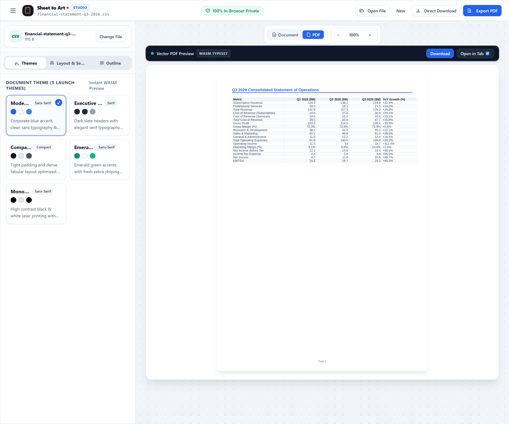

<p align="center">
  
</p>

<h1 align="center">Sheet to Art</h1>

<p align="center"><strong>Turn spreadsheets into publication-grade PDFs — 100% in your browser.</strong></p>

<p align="center">
  <a href="https://yjhacker.github.io/Sheet-to-Art/"></a>
  <a href="https://github.com/YJHacker/Sheet-to-Art/actions/workflows/ci.yml"></a>
  
</p>

**Live demo:** [https://yjhacker.github.io/Sheet-to-Art/](https://yjhacker.github.io/Sheet-to-Art/)

Drop an `.xlsx` or `.csv` and get a typeset PDF with detected sections, KPI grids, tables, notes, consistent column geometry and five print themes. Nothing is uploaded: parsing, layout and typesetting all run in the browser.



<p align="center"><em>The studio with a real Q3 financial report in the vector preview — generated in the browser from a CSV.</em></p>

## Why

Most spreadsheet-to-PDF tools print the grid. Real sheets have structure — title banners, KPI cards, multiple tables, footnotes, merged cells and inconsistent widths. Sheet to Art reads that structure first, then typesets it:

1. **Parse** the workbook into a normalized cell grid (`CellIR`) with styles, merges and sheet metadata.
2. **Understand** the sheet: segment it into typed sections, score candidate header rows, classify columns and allocate widths.
3. **Typeset** with [Typst](https://typst.app/) compiled to WebAssembly, then assemble the PDF and render vector previews.

## Features

- **Semantic section detection** — separates tables, KPI grids and callout notes instead of collapsing a sheet into one table.
- **Deterministic header scoring** — a weighted formula (`0.60 B + 0.30 T + 0.05 F + 0.03 C + 0.02 U`) distinguishes real header rows from title banners.
- **Column classification and width allocation** — infers `number`, `date`, `boolean`, `text` and `mixed` types, aligns values correctly, and uses square-root content weighting so wide text columns do not crush numeric ones.
- **Page geometry optimizer** — switches portrait/landscape and compresses font size (down to 7.5pt) for wide layouts.
- **Five launch themes** — `modern-clean`, `executive-serif`, `compact-ledger`, `emerald-report`, `monochrome-pure`.
- **Multi-sheet workspace** — tab bar and sidebar navigation; each sheet recompiles independently.
- **Dual preview** — vector PDF pages from Typst WASM, or a semantic HTML document view.
- **Live page setup** — A4, Letter, Legal, A3, A5; orientation, margins and font scale.
- **Persistence** — IndexedDB restores the active workbook and your options after a reload.
- **Export** — download with a custom filename, or print from the browser.
- **Responsive UI** — desktop split-pane studio and a mobile layout with a horizontal theme carousel.
- **Private by construction** — no server, no upload, no telemetry, no remote fonts during layout or compilation.

## How it works

```text
.xlsx / .csv
     |
     v
Parser Web Worker  (ExcelJS / PapaParse)
     |  CellIR + styles + merges + sheet metadata
     v
Layout pipeline  (section detection, header scoring, column typing, geometry)
     |  LayoutIR: tables, KPI grids, text sections, page styles
     v
Typst Web Worker  (markup generation + Typst WASM compilation)
     |  PDF buffers + vector page SVGs
     v
Preview / export
```

The main thread talks to the parser, layout and Typst workers over [Comlink](https://github.com/GoogleChromeLabs/comlink) RPC, so parsing and typesetting do not block the UI. `pdf-lib` merges section buffers, stamps metadata and reports page counts.

## Quality

| Check | Result |
|---|---|
| Tests | **170 passing** across **39** Vitest files |
| Types | `tsc --noEmit` clean with `strict` + `noUncheckedIndexedAccess` |
| Build | production Vite build: app, 3 worker chunks, Typst compiler/renderer WASM, local fonts |
| CI | GitHub Actions runs type check, tests and build on every push and pull request |
| Deploy | `master` is tested, built and published to GitHub Pages |

The suite includes unit tests for the parser, section detector, header detector, column classifier/allocator, Typst generator, escaper, PDF assembler and studio store, plus integration flows over a real seven-sheet GATE 2027 workbook and UI journeys for upload, sheet switching, themes, page setup and export.

## Quick start

**Prerequisites:** Node.js 20+ and npm 10+.

```bash
git clone https://github.com/YJHacker/Sheet-to-Art.git
cd Sheet-to-Art
npm ci
npm run dev
```

Open `http://localhost:5173` and drop a spreadsheet (or use the built-in sample).

### Scripts

| Command | What it does |
|---|---|
| `npm run dev` | Vite dev server with HMR |
| `npm test` | Run the full Vitest suite once |
| `npm run test:watch` | Vitest in watch mode |
| `npx tsc --noEmit` | Strict type check |
| `npm run build` | Type check and build to `dist/` |

Production builds use `base: /Sheet-to-Art/` for GitHub Pages; the dev server stays at `/`. Change the `base` value in `vite.config.ts` if you host it under a different path.

## Tech stack

| Layer | Technology |
|---|---|
| UI | React 18, TypeScript, Vite 5, Tailwind CSS |
| State | Zustand |
| Spreadsheet ingestion | ExcelJS (XLSX), PapaParse (CSV) |
| Layout engine | Custom deterministic TypeScript |
| Typesetting | `@myriaddreamin/typst.ts` (Typst WASM), `pdf-lib` |
| Workers | Dedicated Web Workers + Comlink RPC |
| Tests | Vitest, Testing Library, jsdom |

## Project structure

```text
index.html
src/
  components/     studio UI, preview, sidebar, header, modals
  lib/
    layout/       section detection, header scoring, column geometry
    pipeline/     document orchestration
    storage/      IndexedDB persistence
    typst/        markup generation, WASM compiler, themes
    utils/
  store/          Zustand studio state
  types/          CellIR, LayoutIR and shared contracts
  workers/        parser, layout and Typst workers
tests/
  unit/           parser, layout, typesetting, UI primitives
  integration/    end-to-end flows and real-workbook acceptance
docs/             architecture specs and sprint plans
logo_sheettoart/  brand assets
```

## Limitations and roadmap

- The Typst compiler WASM is about **29 MB** on first load. It is cached afterwards, but lazy-loading and splitting it is the next performance win.
- Sprint 5 — preset templates, batch multi-sheet export and final polish — is **planned, not shipped**.
- Layout heuristics are tuned on real academic planning workbooks. Unusual sheet shapes may need rule tuning.
- UI behaviour is covered in jsdom; there is no Playwright browser suite yet.
- Very wide, multi-table sheets are still best handled on a desktop viewport.

Roadmap:

- [ ] Preset templates and batch multi-sheet export (Sprint 5)
- [ ] Lazy-load and split the Typst WASM bundle
- [ ] Playwright end-to-end coverage in Chromium and WebKit
- [ ] Upgrade Vite/Typst and clear remaining dependency advisories
- [ ] Manual section correction for ambiguous sheets

## Documentation

- [Architecture specification](docs/superpowers/specs/2026-09-21-spreadsheet-pdf-engine-design.md)
- [Sprint 1 plan — parser and CellIR](docs/superpowers/plans/2026-09-21-sprint-1-parser-cell-ir.md)
- [Sprint 2 plan — layout heuristics](docs/superpowers/plans/2026-09-22-sprint-2-layout-heuristics-section-engine.md)
- [Sprint 3 plan — Typst WASM pipeline](docs/superpowers/plans/2026-09-23-sprint-3-typst-wasm-pdf-pipeline.md)
- [Worker architecture](src/workers/README.md)

## License

MIT © 2026 Yash Chauhan — see [LICENSE](LICENSE).
